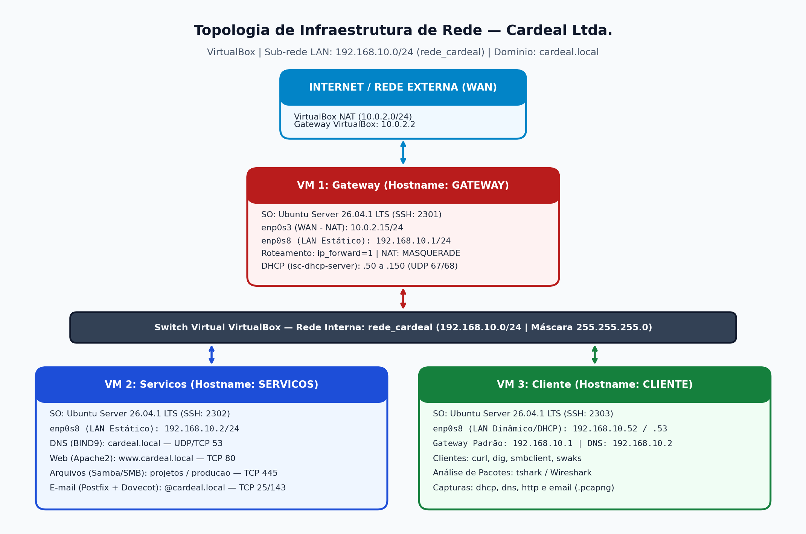

# Infraestrutura de Rede Corporativa — Cardeal Ltda.

**Universidade Federal de Pelotas (UFPel)**  
**Centro de Desenvolvimento Tecnológico (CDTec)**  
**Disciplina:** Redes de Computadores  

Repositório contendo os scripts de configuração, arquivos de referência dos serviços, diagrama de topologia, capturas de pacotes do Wireshark (`.pcapng`) e o relatório técnico da infraestrutura de rede da empresa hipotética **Cardeal Ltda.**

---

## Topologia da Rede



- **Sub-rede LAN (`rede_cardeal`):** `192.168.10.0/24` (Máscara `255.255.255.0`)
- **Domínio Interno:** `cardeal.local`
- **VM 1 — `Gateway` (Hostname `GATEWAY` | `192.168.10.1`):** Roteamento (`ip_forward=1`), NAT (`iptables MASQUERADE`) e DHCP (`isc-dhcp-server`, faixa `192.168.10.50` a `192.168.10.150`).
- **VM 2 — `Servicos` (Hostname `SERVICOS` | `192.168.10.2`):** DNS (`BIND9`), Web (`Apache2`), Arquivos (`Samba/SMB`) e Correio Eletrônico (`Postfix` + `Dovecot`).
- **VM 3 — `Cliente` (Hostname `CLIENTE` | `192.168.10.52` / `.53` via DHCP):** Estação cliente para validação dos serviços (`curl`, `dig`, `smbclient`, `swaks`) e captura de pacotes (`tshark`/Wireshark).

---

## Estrutura do Repositório

```text
cardeal-rede/
├── topologia/
│   └── topologia.png                       # Diagrama da topologia de rede
├── gateway/
│   ├── 99-lan.yaml                         # Netplan da interface LAN (192.168.10.1/24)
│   └── iptables-nat.sh                     # IP Forwarding e regras NAT (MASQUERADE)
├── dhcp/
│   ├── isc-dhcp-server                     # Definição da interface LAN (enp0s8)
│   └── dhcpd.conf                          # Escopo DHCP (.50 a .150), gateway e DNS
├── dns/
│   ├── named.conf.options                  # Opções e forwarders do BIND9
│   ├── named.conf.local                    # Declaração da zona cardeal.local
│   └── db.cardeal.local                    # Registros SOA, NS, MX e A (www, mail, ns1, gateway)
├── web/
│   ├── cardeal.conf                        # VirtualHost Apache2 (www.cardeal.local)
│   └── index.html                          # Página institucional da intranet
├── email/
│   └── main.cf                             # Configuração do Postfix (@cardeal.local / Maildir)
├── smb/
│   └── smb.conf                            # Compartilhamentos Samba (projetos e producao)
├── scripts/
│   ├── clone-and-setup-vms.sh              # Clonagem e configuração das 3 VMs no VirtualBox
│   ├── setup-gateway-ubuntu.sh             # Provisionamento da VM 1 (Gateway / NAT / DHCP)
│   ├── setup-services-ubuntu.sh            # Provisionamento da VM 2 (DNS / Web / SMB / E-mail)
│   ├── setup-client-ubuntu.sh              # Provisionamento da VM 3 (Cliente / DHCP / tshark)
│   ├── verify-all.sh                       # Diagnóstico automatizado das 3 camadas na VM 3
│   └── capture-wireshark.sh                # Captura automatizada dos 4 arquivos .pcapng
├── wireshark/
│   ├── dhcp.pcapng                         # Ciclo DORA completo (UDP 67/68)
│   ├── dns.pcapng                          # Consulta e resposta A www.cardeal.local (UDP 53)
│   ├── http.pcapng                         # Handshake TCP + GET http://www.cardeal.local/ (TCP 80)
│   └── email.pcapng                        # Sessão SMTP completa (TCP 25)
└── relatorio/
    ├── relatorio_final.md                  # Relatório técnico completo
    └── guia_passo_a_passo_conjunto2.md     # Memorial passo a passo com resolução de erros
```

---

## Como Reproduzir e Validar

1. **Clonar as 3 VMs no VirtualBox (a partir de `VM-BASE` Ubuntu Server):**
   ```bash
   bash scripts/clone-and-setup-vms.sh
   ```
2. **Configurar cada máquina via SSH (`2301`, `2302` e `2303`):**
   - Na `Gateway`: `bash setup-gateway-ubuntu.sh`
   - Na `Servicos`: `bash setup-services-ubuntu.sh`
   - Na `Cliente`: `bash setup-client-ubuntu.sh`
3. **Executar bateria de diagnóstico e capturas na `Cliente`:**
   ```bash
   bash verify-all.sh
   bash capture-wireshark.sh
   ```
