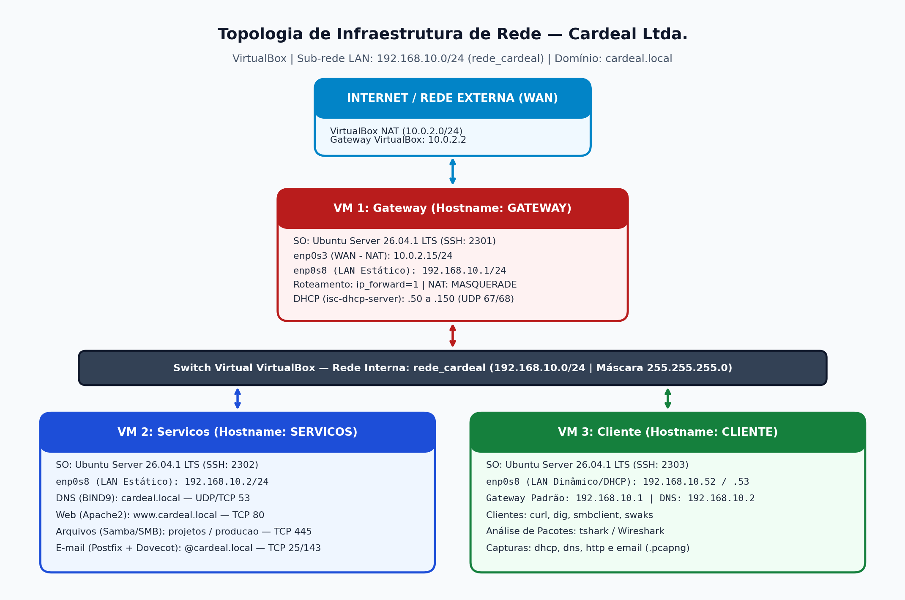

# Relatório Técnico: Projeto de Infraestrutura Corporativa — Cardeal Ltda.

**Instituição:** Universidade Federal de Pelotas (UFPel)  
**Unidade:** Centro de Desenvolvimento Tecnológico (CDTec)  
**Curso:** Bacharelado em Ciência da Computação / Engenharia de Computação  
**Disciplina:** Redes de Computadores  
**Autor:** Rafael  

---

## 1. Descrição da Infraestrutura Implementada e Topologia

O presente projeto teve como objetivo projetar, implementar e validar a infraestrutura de rede local (LAN) e borda de rede (WAN) para a empresa hipotética **Cardeal Ltda.** A solução atende às demandas internas dos funcionários — troca de e-mails internos, acesso à página Web institucional, acesso a arquivos compartilhados para controle da produção e gerenciamento de projetos — bem como permite o acesso controlado à Internet externa.

### 1.1. Serviços Implementados
1. **Gateway / Roteador de Borda (WAN/LAN, IP Forwarding e NAT):** Encaminhamento de pacotes IPv4 no kernel Linux (`net.ipv4.ip_forward = 1`) e mascaramento de endereços de saída via `iptables` (`POSTROUTING MASQUERADE`), conectando a LAN interna à WAN externa.
2. **Servidor DHCP (`isc-dhcp-server`):** Distribuição automática da faixa dinâmica de endereços IP (`192.168.10.50` a `192.168.10.150`, excluindo os IPs fixos dos servidores), máscara de sub-rede (`255.255.255.0`), gateway padrão (`192.168.10.1`), servidor DNS (`192.168.10.2`) e sufixo de domínio (`cardeal.local`).
3. **Servidor DNS (`BIND9`):** Gerenciamento autoritativo do domínio interno **`cardeal.local`**, resolvendo os nomes dos servidores da rede (`www.cardeal.local`, `mail.cardeal.local`, `ns1.cardeal.local`, `gateway.cardeal.local`), registro `MX` de correio eletrônico e encaminhamento (*forwarders*) para resolução de domínios externos.
4. **Servidor Web (`Apache2`):** Hospedagem da página institucional da Cardeal Ltda. em endereço IP estático (`192.168.10.2`), acessível na rede interna por **`http://www.cardeal.local/`** (porta TCP `80`).
5. **Servidor de Arquivos (`Samba / SMB`):** Alternativa corporativa ao FTP para compartilhamento de arquivos na rede local (porta TCP `445`), provendo os diretórios `projetos` e `producao`.
6. **Servidor de Correio Eletrônico (`Postfix` + `Dovecot`):** Troca interna de mensagens em endereço estático (`192.168.10.2`) para contas no formato **`usuario@cardeal.local`** (`joao@cardeal.local` e `maria@cardeal.local`), operando com SMTP (porta TCP `25`) para envio/entrega e IMAP (porta TCP `143`) sobre caixas `Maildir` para leitura.

### 1.2. Topologia da Rede

---

## 2. Configuração das Máquinas Virtuais

O ambiente foi criado no **Oracle VM VirtualBox** utilizando **3 Máquinas Virtuais** com **Ubuntu Server 26.04.1 LTS (64-bit)** em modo texto (sem interface gráfica), reduzindo drasticamente o consumo de memória RAM (~150 MB por servidor) conforme recomendado na especificação do projeto. As 3 máquinas foram clonadas de uma imagem base limpa (`VM-BASE`) gerando novos endereços MAC em todas as interfaces para evitar conflitos na Camada de Enlace.

| Máquina Virtual (VirtualBox) | Hostname | Sistema Operacional | Placas de Rede (VirtualBox) | Função / Serviços |
| :--- | :--- | :--- | :--- | :--- |
| **`Gateway`** (VM 1) | `GATEWAY` | Ubuntu Server 26.04.1 LTS | **Adaptador 1 (`enp0s3`):** NAT (WAN + Port Forwarding SSH `2301`) **Adaptador 2 (`enp0s8`):** Rede Interna `rede_cardeal` (LAN) | Roteamento (`ip_forward`), NAT (`iptables MASQUERADE`) e servidor DHCP (`isc-dhcp-server`). |
| **`Servicos`** (VM 2) | `SERVICOS` | Ubuntu Server 26.04.1 LTS | **Adaptador 1 (`enp0s3`):** NAT (gerência SSH `2302`) **Adaptador 2 (`enp0s8`):** Rede Interna `rede_cardeal` (LAN) | BIND9 (DNS), Apache2 (Web), Samba (SMB), Postfix (SMTP) e Dovecot (IMAP). |
| **`Cliente`** (VM 3) | `CLIENTE` | Ubuntu Server 26.04.1 LTS | **Adaptador 1 (`enp0s3`):** NAT (gerência SSH `2303`) **Adaptador 2 (`enp0s8`):** Rede Interna `rede_cardeal` (LAN) | Estação de trabalho cliente (`curl`, `dig`, `smbclient`, `swaks`) e analisador de pacotes (`tshark` / Wireshark). |

---

## 3. Endereçamento IP Utilizado

Na rede interna `rede_cardeal`, adotou-se o bloco privado **Classe C (RFC 1918)** `192.168.10.0/24`. Os endereços `192.168.10.1` a `192.168.10.49` ficaram reservados para infraestrutura/servidores com IP estático, enquanto o intervalo `192.168.10.50` a `192.168.10.150` foi destinado à concessão automática pelo servidor DHCP.

| Parâmetro / Equipamento | Endereço IPv4 | Máscara de Sub-rede | Tipo de Alocação | Observações |
| :--- | :--- | :--- | :--- | :--- |
| **Sub-rede LAN (`rede_cardeal`)** | `192.168.10.0/24` | `255.255.255.0` | Rede privada (RFC 1918) | Endereço de Broadcast: `192.168.10.255` |
| **VM 1 — `Gateway` (`enp0s8` LAN)** | `192.168.10.1` | `255.255.255.0` | Estático (Netplan) | Default Gateway da LAN e Servidor DHCP |
| **VM 1 — `Gateway` (`enp0s3` WAN)** | `10.0.2.15` | `255.255.255.0` | Dinâmico (VirtualBox NAT) | Saída externa WAN (Gateway VirtualBox `10.0.2.2`) |
| **VM 2 — `Servicos` (`enp0s8` LAN)** | `192.168.10.2` | `255.255.255.0` | Estático (Netplan) | Hospeda DNS (`ns1`), Web (`www`), E-mail (`mail`) e SMB |
| **Escopo Dinâmico DHCP** | `192.168.10.50` – `192.168.10.150` | `255.255.255.0` | Dinâmico (`isc-dhcp-server`) | Lease padrão `600s` (máx. `7200s`); entrega Gateway `.1`, DNS `.2` e domínio `cardeal.local` |
| **VM 3 — `Cliente` (`enp0s8` LAN)** | `192.168.10.52` / `192.168.10.53` | `255.255.255.0` | Dinâmico via DHCP | Recebido automaticamente de `192.168.10.1` (MAC `08:00:27:e1:45:53`) |

---

## 4. Testes Realizados para Verificação da Infraestrutura

A partir da máquina **`Cliente`** (`CLIENTE`), foram executados os seguintes testes práticos para comprovar o funcionamento integrado de todos os serviços:

1. **Concessão e renovação de endereço via DHCP:**
   - Comando: `sudo dhclient -r enp0s8 && sudo dhclient -v enp0s8`
   - Resultado: A interface `enp0s8` liberou a concessão anterior (`.52`) e concluiu o ciclo `DHCPDISCOVER` $\rightarrow$ `DHCPOFFER` $\rightarrow$ `DHCPREQUEST` $\rightarrow$ `DHCPACK` junto ao servidor `192.168.10.1`, recebendo `192.168.10.53/24`, Gateway `192.168.10.1`, DNS `192.168.10.2` e domínio `cardeal.local`.
2. **Resolução de nomes e registro de correio no DNS (`BIND9`):**
   - Comandos: `dig www.cardeal.local +short` e `dig cardeal.local MX +short`
   - Resultado: Retorno imediato de `192.168.10.2` (registro `A`) e `10 mail.cardeal.local.` (registro `MX`) pelo servidor DNS `192.168.10.2`.
3. **Acesso à página Web interna via nome de domínio (`Apache2`):**
   - Comando: `curl http://www.cardeal.local/`
   - Resultado: Resolução automática de `www.cardeal.local` e retorno `HTTP/1.1 200 OK` com o documento HTML completo da Intranet Corporativa da Cardeal Ltda.
4. **Acesso aos diretórios compartilhados via SMB (`Samba`):**
   - Comando: `smbclient -L //192.168.10.2 -N`
   - Resultado: Listagem e acesso bem-sucedidos aos compartilhamentos corporativos `projetos` e `producao` sobre TCP `445`.
5. **Troca interna de correio eletrônico (`Postfix` / `Dovecot`):**
   - Comando: `swaks --to joao@cardeal.local --from maria@cardeal.local --server mail.cardeal.local --body "Teste manual do laboratorio!"`
   - Resultado: Conexão SMTP aceita em `mail.cardeal.local:25`, remetente e destinatário validados (`250 2.1.0 Ok` / `250 2.1.5 Ok`), mensagem enfileirada (`250 2.0.0 Ok: queued as A592AE113B`) e entregue na caixa `/home/joao/Maildir/new/` da VM `Servicos`.
6. **Roteamento de borda e acesso à Internet externa via NAT:**
   - Comandos: `ip route get 8.8.8.8` e `curl -I --max-time 5 http://example.com`
   - Resultado: Confirmação da rota padrão saindo pela LAN via Gateway (`default via 192.168.10.1 dev enp0s8 metric 50`), resposta `HTTP/1.1 200 OK` da Internet externa e incremento dos contadores de pacotes nas cadeias `POSTROUTING (MASQUERADE)` e `FORWARD` do `iptables` na VM `Gateway`. Ao desativar temporariamente `net.ipv4.ip_forward=0` no Gateway, o acesso externo cessou imediatamente, comprovando o papel efetivo do roteador.

---

## 5. Identificação dos Protocolos (Camada de Aplicação até Camada de Rede)

Fundamentado no conteúdo teórico das **Unidades 2 (Aplicação), 3 (Transporte) e 4 (Rede)** da disciplina, o quadro abaixo demonstra toda a pilha de protocolos envolvida em cada serviço implementado:

| Serviço / Operação | Camada de Aplicação (Unidade 2) | Camada de Transporte (Unidade 3) | Porta(s) | Camada de Rede (Unidade 4) | Justificativa Técnica |
| :--- | :--- | :--- | :---: | :--- | :--- |
| **Configuração automática de IP** | **DHCP** (RFC 2131) | **UDP** | `67` (Srv) / `68` (Cli) | **IPv4** (`0.0.0.0` / Broadcast `255.255.255.255`) | Não orientado à conexão; viabiliza difusão local antes de o host possuir endereço IP, onde um handshake TCP seria impossível. |
| **Resolução de nomes de domínio** | **DNS** (RFC 1035) | **UDP** (padrão) / TCP | `53` | **IPv4** | Consultas e respostas curtas em mensagem única; o UDP evita o atraso de estabelecimento de conexão (baixa latência). |
| **Acesso à página Web** | **HTTP/1.1** (RFC 2616) | **TCP** | `80` | **IPv4** | Requer **transferência confiável de dados**, entrega ordenada e sem perdas, assegurada pelo *Three-Way Handshake*, ACKs e controle de fluxo/congestionamento do TCP. |
| **Envio de e-mail corporativo** | **SMTP** (RFC 5321) | **TCP** | `25` | **IPv4** | Exige entrega confiável dos comandos de envelope (`MAIL FROM`, `RCPT TO`) e do conteúdo (`DATA`) sem corrupção. |
| **Leitura de caixa postal** | **IMAP** (RFC 3501) | **TCP** | `143` | **IPv4** | Mantém sessão confiável e sincronizada para leitura das mensagens armazenadas em `Maildir`. |
| **Compartilhamento de arquivos** | **SMB** | **TCP** | `445` | **IPv4** | Garante integridade estrita de bytes na leitura e gravação de arquivos de projetos e produção em rede. |
| **Diagnóstico de conectividade** | — | — | — | **ICMP** sobre **IPv4** | Mensagens *Echo Request / Echo Reply* (`ping`) na própria Camada de Rede para teste de alcançabilidade. |

*(Adicionalmente, na **Camada de Enlace — Unidade 5**, todas as trocas dentro do domínio de broadcast `rede_cardeal` operam sobre quadros **Ethernet II** e resolução de endereços físicos via protocolo **ARP**).*

---

## 6. Capturas Realizadas com o Wireshark e Análise Detalhada

As 4 capturas obrigatórias foram coletadas na interface interna `enp0s8` da máquina **`Cliente`** (`CLIENTE`) e encontram-se salvas no diretório `wireshark/`.

---

### 6.1. Captura do DHCP (`wireshark/dhcp.pcapng`)

> **[INSERIR AQUI O PRINT DO WIRESHARK COM O ARQUIVO `wireshark/dhcp.pcapng` ABERTO — FILTRO: `dhcp`]**

#### Análise e Resposta ao Item 2.a do Enunciado
Foram capturados **5 pacotes** sobre **UDP (portas 68 e 67)** registrando a liberação do IP anterior e as 4 mensagens do ciclo **DORA** (*Discover, Offer, Request, Acknowledge*) para a placa do cliente (`MAC 08:00:27:e1:45:53`):

| Nº | Mensagem DHCP | IP de Origem | Porta Origem | IP de Destino | Porta Destino | Explicação Técnica |
| :---: | :--- | :--- | :---: | :--- | :---: | :--- |
| **1** | **DHCP Release** | `192.168.10.52` | `68` | `192.168.10.1` | `67` | Cliente encerra a concessão anterior (`dhclient -r`) diretamente junto ao Gateway. |
| **2** | **DHCP Discover** | **`0.0.0.0`** | `68` | **`255.255.255.255`** | `67` | Desprovido de IP, o cliente transmite em *broadcast* local procurando servidores DHCP ativos. |
| **3** | **DHCP Offer** | **`192.168.10.1`** | `67` | **`192.168.10.53`** | `68` | O servidor DHCP (`Gateway`, `192.168.10.1`) oferece o endereço `192.168.10.53`, máscara `255.255.255.0`, roteador `192.168.10.1`, DNS `192.168.10.2`, domínio `cardeal.local` e *lease* de `600s`. |
| **4** | **DHCP Request** | **`0.0.0.0`** | `68` | **`255.255.255.255`** | `67` | O cliente solicita formalmente o endereço ofertado (`192.168.10.53`) em *broadcast* identificando o `Server-ID 192.168.10.1`. |
| **5** | **DHCP ACK** | **`192.168.10.1`** | `67` | **`192.168.10.53`** | `68` | O servidor confirma a alocação (*Acknowledge*) e o cliente passa a operar com o IP `192.168.10.53`. |

---

### 6.2. Captura do DNS (`wireshark/dns.pcapng`)

> **[INSERIR AQUI O PRINT DO WIRESHARK COM O ARQUIVO `wireshark/dns.pcapng` ABERTO — FILTRO: `dns`]**

#### Análise e Resposta ao Item 2.b do Enunciado
Foram capturados **2 pacotes** sobre **UDP (porta 53)** referentes à transação `0xd073` (`53363`):

1. **Qual foi o nome da consulta?**  
   - **`www.cardeal.local`** (consulta padrão pelo registro tipo **`A`** — endereço IPv4).
2. **Qual servidor respondeu à consulta?**  
   - **`192.168.10.2`** (Servidor DNS autoritativo **BIND9** hospedado na VM `Servicos`).

* **Detalhamento dos pacotes:**
  - **Pacote 1 (Consulta):** `192.168.10.52:34607` $\rightarrow$ `192.168.10.2:53` — `Standard query 0xd073 A www.cardeal.local`.
  - **Pacote 2 (Resposta):** `192.168.10.2:53` $\rightarrow$ `192.168.10.52:34607` — `Standard query response 0xd073 A www.cardeal.local A 192.168.10.2` (flag autoritativa ativa, `NoError`, TTL `604800s`, tempo de resposta `0,88 ms`).

---

### 6.3. Captura do HTTP (`wireshark/http.pcapng`)

> **[INSERIR AQUI O PRINT DO WIRESHARK COM O ARQUIVO `wireshark/http.pcapng` ABERTO — FILTRO: `http or tcp.port == 80`]**

#### Análise e Resposta ao Item 2.c do Enunciado
Foram capturados **10 pacotes** sobre **TCP (porta 80)** demonstrando o estabelecimento da conexão confiável, a requisição da página e o encerramento da sessão:

1. **Estabelecimento da Conexão TCP (*Three-Way Handshake*):**
   - **Pacote 1 (`[SYN]`):** Cliente `192.168.10.52:57774` $\rightarrow$ Servidor `192.168.10.2:80` (`Seq=0`).
   - **Pacote 2 (`[SYN, ACK]`):** Servidor `192.168.10.2:80` $\rightarrow$ Cliente `192.168.10.52:57774` (`Seq=0, Ack=1`).
   - **Pacote 3 (`[ACK]`):** Cliente `192.168.10.52:57774` $\rightarrow$ Servidor `192.168.10.2:80` (`Seq=1, Ack=1`).
2. **Requisição `GET` e URL da página:**
   - **Pacote 4 (`[PSH, ACK]`):** Envio da mensagem `GET / HTTP/1.1` contendo o cabeçalho **`Host: www.cardeal.local`**.
   - **Qual é a URL da página que aparece na mensagem?**  
     - **`http://www.cardeal.local/`** (exibida no campo `[Full request URI: http://www.cardeal.local/]` do dissector HTTP do Wireshark).
3. **Resposta do Servidor e Fechamento TCP:**
   - **Pacote 6 (`[PSH, ACK]`):** O Apache2 (`192.168.10.2:80`) responde com **`HTTP/1.1 200 OK`** (`Content-Type: text/html`) entregando a página institucional da Cardeal Ltda.
   - **Pacotes 8, 9 e 10:** Encerramento ordenado da conexão TCP por meio dos segmentos `[FIN, ACK]` e `[ACK]`.

---

### 6.4. Captura do E-mail (`wireshark/email.pcapng`)

> **[INSERIR AQUI O PRINT DO WIRESHARK COM O ARQUIVO `wireshark/email.pcapng` ABERTO — FILTRO: `tcp.port == 25`]**

#### Análise e Resposta ao Item 2.d do Enunciado
Foram capturados **22 pacotes** sobre **TCP (porta 25)** documentando a transmissão completa de um e-mail interno de `maria@cardeal.local` para `joao@cardeal.local`:

1. **Indicar qual protocolo / parte iniciou a comunicação para a troca de mensagens:**
   - Utilizou-se o protocolo **SMTP (*Simple Mail Transfer Protocol*)** operando sobre **TCP (porta 25)**.
   - Na **Camada de Transporte (TCP)**, o **cliente (`192.168.10.52:40460`)** iniciou a comunicação solicitando a abertura da conexão com o segmento `[SYN]` para `192.168.10.2:25` (concluindo o *Three-Way Handshake* nos pacotes 1 a 3).
   - Na **Camada de Aplicação (SMTP)**, assim que o canal TCP foi estabelecido, o **servidor (`192.168.10.2`)** enviou a primeira mensagem do protocolo — o banner de saudação **`220 mail.cardeal.local ESMTP Postfix (Ubuntu)`** (Pacote 4) — e em seguida o **cliente** iniciou os comandos de envio com **`EHLO CLIENTE`** (Pacote 6).
2. **Fluxo completo de mensagens SMTP observado:**
   - `Servidor -> Cliente:` `220 mail.cardeal.local ESMTP Postfix (Ubuntu)`
   - `Cliente -> Servidor:` `EHLO CLIENTE` $\rightarrow$ `Servidor:` `250-mail.cardeal.local` (lista de capacidades ESMTP)
   - `Cliente -> Servidor:` `MAIL FROM:<maria@cardeal.local>` $\rightarrow$ `Servidor:` `250 2.1.0 Ok`
   - `Cliente -> Servidor:` `RCPT TO:<joao@cardeal.local>` $\rightarrow$ `Servidor:` `250 2.1.5 Ok`
   - `Cliente -> Servidor:` `DATA` $\rightarrow$ `Servidor:` `354 End data with <CR><LF>.<CR><LF>`
   - `Cliente -> Servidor:` Cabeçalhos e corpo da mensagem $\rightarrow$ `Servidor:` `250 2.0.0 Ok: queued as A592AE113B`
   - `Cliente -> Servidor:` `QUIT` $\rightarrow$ `Servidor:` `221 2.0.0 Bye` (seguido de encerramento TCP `FIN/ACK`).

---

## 7. Justificativas das Decisões Tomadas

1. **Distribuição dos serviços entre as 3 VMs:**
   - A VM **`Gateway`** foi dedicada exclusivamente às funções de borda (roteamento entre WAN e LAN, NAT e DHCP), isolando a exposição à rede externa e evitando que eventuais falhas em serviços de usuário interrompam a conectividade da empresa.
   - A VM **`Servicos`** consolidou os servidores internos de aplicação (DNS, Web, SMB e E-mail) sob um único IP fixo (`192.168.10.2`), otimizando o uso de recursos de hardware do hospedeiro sem abrir mão da separação em relação ao roteador e aos clientes.
   - A VM **`Cliente`** permaneceu desacoplada dos servidores para validar fielmente a experiência de um colaborador real na LAN (autoconfiguração por DHCP, resolução DNS e captura isenta de tráfego de loopback).
2. **Uso do Ubuntu Server sem interface gráfica:** Atendeu à recomendação de baixo consumo de memória RAM (~150 MB por VM) e reproduziu o padrão real de administração de servidores Linux via SSH e arquivos de configuração.
3. **Escolha do protocolo SMB (`Samba`) em substituição ao FTP:** O SMB permite montagem transparente de diretórios de rede com controle de permissões nativo e utiliza uma única conexão TCP (`445`), superando as fragilidades do FTP tradicional (credenciais sem cifragem e múltiplas portas de controle/dados que dificultam firewalls).
4. **Pilha BIND9 + Apache2 + Postfix/Dovecot + ISC-DHCP:** Softwares livres amplamente consolidados em produção e totalmente aderentes às RFCs estudadas em aula.

---

## 8. Dificuldades Encontradas e Soluções Adotadas

Durante a construção e validação prática da infraestrutura, destacaram-se os seguintes problemas reais e as soluções adotadas:

| Dificuldade Encontrada | Causa Identificada | Solução Adotada |
| :--- | :--- | :--- |
| **1. Travamento de terminal gráfico e alto uso de memória na tentativa inicial com GUI** | Na primeira tentativa com Debian 13 (testing) em modo gráfico (Wayland), o `gnome-terminal` não abria no VirtualBox e a área de transferência ficava indisponível sem *Guest Additions*. | Migração das 3 VMs para **Ubuntu Server em modo texto**, com acesso administrativo via **SSH Port Forwarding** (`2301`, `2302`, `2303`) a partir do terminal nativo do notebook. |
| **2. Bloqueio do `apt`/`dpkg` no boot e conflito entre `ufw` e `iptables-persistent`** | O serviço `unattended-upgrades` (e seu processo filho `dpkg`) bloqueava `/var/lib/dpkg/lock-frontend` logo após iniciar a VM; além disso, o pacote `ufw` pré-instalado conflitava com o `iptables-persistent`. | Parada dos serviços `unattended-upgrades`/`apt-daily`, reparo com `apt --fix-broken install` e remoção explícita do `ufw` (`apt install iptables-persistent ufw-`). |
| **3. Falha ao resolver `www.cardeal.local` no `curl` do cliente** | O serviço `systemd-resolved` do Ubuntu intercepta por padrão domínios terminados em `.local` tratando-os como mDNS (RFC 6762) em vez de consultar o servidor DNS unicast (`192.168.10.2`). | Desativação do `systemd-resolved` na VM `Cliente`, apontamento direto de `/etc/resolv.conf` para `nameserver 192.168.10.2` e ajuste de `/etc/nsswitch.conf` para `hosts: files dns`. |
| **4. Prioridade de rota padrão e bloqueio de ICMP externo na rede universitária** | Com duas interfaces na VM `Cliente`, era necessário garantir saída pela LAN; além disso, na rede Wi-Fi da universidade (`WUFPEL-Anglo`), testes com `ping 8.8.8.8` sofriam bloqueio de ICMP externo mesmo com NAT ativo. | Definição de `route-metric: 50` na `enp0s8` via Netplan (priorizando o Gateway `192.168.10.1`) e validação do acesso externo via HTTP (`curl -I http://example.com` $\rightarrow$ `200 OK`) combinada à inspeção dos contadores `MASQUERADE` no `iptables`. |
| **5. Permissão negada ao ler capturas `.pcapng` geradas pelo `tshark`** | Executar `sudo tshark` gravava arquivos pertencentes a `root` (`0600`), impedindo leitura direta e transferência via `scp` pelo usuário padrão. | Inclusão do usuário no grupo `wireshark` (`usermod -aG wireshark user` com `wireshark-common/install-setuid = true`) e uso do parâmetro `-a duration:6`, permitindo capturar e exportar sem `sudo`. |

---

## 9. Scripts e Organização dos Arquivos Entregues

Todos os scripts desenvolvidos, configurações de referência e capturas seguem a estrutura de diretórios recomendada no enunciado:

- **`topologia/`** — Diagrama visual da arquitetura ([`topologia.png`](../topologia/topologia.png)).
- **`gateway/`** — Configuração Netplan da LAN ([`99-lan.yaml`](../gateway/99-lan.yaml)) e script de regras NAT/Forward ([`iptables-nat.sh`](../gateway/iptables-nat.sh)).
- **`dhcp/`** — Interface de escuta ([`isc-dhcp-server`](../dhcp/isc-dhcp-server)) e escopo de endereços ([`dhcpd.conf`](../dhcp/dhcpd.conf)).
- **`dns/`** — Opções/forwarders ([`named.conf.options`](../dns/named.conf.options)), declaração da zona ([`named.conf.local`](../dns/named.conf.local)) e registros de `cardeal.local` ([`db.cardeal.local`](../dns/db.cardeal.local)).
- **`web/`** — VirtualHost Apache ([`cardeal.conf`](../web/cardeal.conf)) e página institucional ([`index.html`](../web/index.html)).
- **`email/`** — Parâmetros principais do Postfix ([`main.cf`](../email/main.cf)).
- **`smb/`** — Compartilhamentos Samba `projetos` e `producao` ([`smb.conf`](../smb/smb.conf)).
- **`scripts/`** — Scripts completos de clonagem ([`clone-and-setup-vms.sh`](../scripts/clone-and-setup-vms.sh)), provisionamento das 3 VMs ([`setup-gateway-ubuntu.sh`](../scripts/setup-gateway-ubuntu.sh), [`setup-services-ubuntu.sh`](../scripts/setup-services-ubuntu.sh), [`setup-client-ubuntu.sh`](../scripts/setup-client-ubuntu.sh)), diagnóstico ([`verify-all.sh`](../scripts/verify-all.sh)) e captura automatizada ([`capture-wireshark.sh`](../scripts/capture-wireshark.sh)).
- **`wireshark/`** — Arquivos de captura reais: [`dhcp.pcapng`](../wireshark/dhcp.pcapng), [`dns.pcapng`](../wireshark/dns.pcapng), [`http.pcapng`](../wireshark/http.pcapng) e [`email.pcapng`](../wireshark/email.pcapng).
- **`relatorio/`** — Este relatório técnico ([`relatorio_final.md`](relatorio_final.md)) e o memorial passo a passo de implementação ([`guia_passo_a_passo_conjunto2.md`](guia_passo_a_passo_conjunto2.md)).
